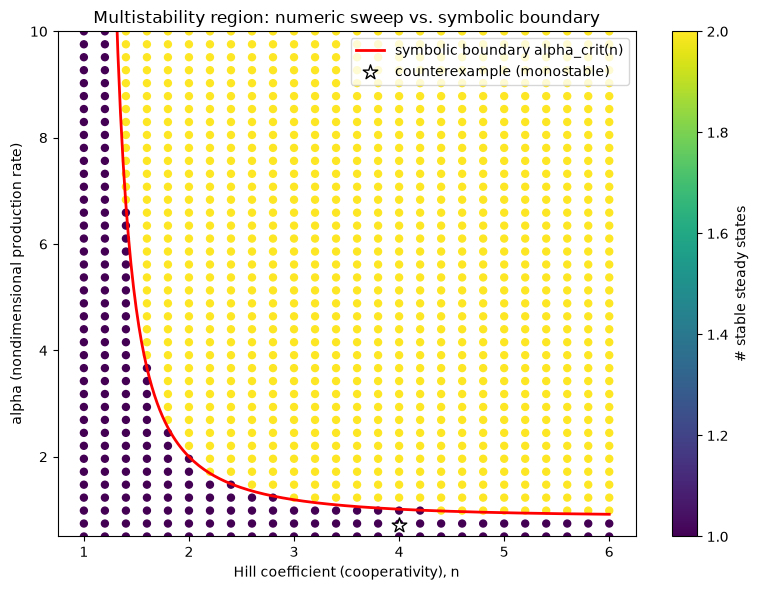

# Structural Constraints on Multistability in Gene-Regulatory Networks

Does a positive-feedback (mutual-repression) wiring diagram alone guarantee that a gene-regulatory circuit
can settle into more than one stable state? A derived, closed-form condition and an explicit, verified
counterexample — not another simulation of a textbook toggle switch that happens to already be bistable.

## 1. Aim

Turn "positive feedback causes multistability," a claim usually left at the level of intuition in systems
biology, into a precise, derivable, checkable condition — and construct a real counterexample to show that
topology alone is necessary but not sufficient.

## 2. Objective

1. Build the minimal real model class capable of multistability: a two-gene mutual-repression ODE system
   with Hill-function cooperativity.
2. Find every real steady state via root-finding (not trajectory simulation, which can silently miss
   states) and classify each one's stability via its Jacobian.
3. Sweep parameters to numerically map the bistable region, then derive that region's exact boundary in
   closed form with SymPy, requiring the two to agree as a built-in correctness check.
4. Deliberately construct a counterexample: a model with mutual repression present but provably
   monostable.

## 3. Data fetch

None — a deliberate, disclosed exception to this portfolio's usual API-first-data convention. The
mathematical model and its parameter space are the object of study; there is no dataset to fetch. An
optional empirical anchor (the real published Gardner, Cantor & Collins 2000 synthetic *E. coli* toggle
switch) is used only afterward, as a plausibility check against a real physically constructed circuit, not
as the project's primary evidence.

## 4. Data describe

Not applicable in the usual sense — the "data" here is the model's own parameter space: cooperativity
(Hill coefficient `n`, swept 1.0-6.0) and nondimensional production rate (`alpha`, swept 0.5-10.0), a
40×26 grid of 1,040 parameter combinations, each resolved into a real steady-state count and stability
classification.

## 5. Methods / Workflow

1. Define the symmetric two-gene mutual-repression ODE system (nondimensional form); build its symbolic
   Jacobian with SymPy, lambdified for fast numeric evaluation.
2. Find all real steady states at a representative parameter point via `scipy.optimize.fsolve`, run from a
   diverse, `alpha`-scaled set of initial guesses and de-duplicated.
3. Classify each steady state's stability via Jacobian eigenvalues (all negative real part = stable).
4. Sweep the full `(n, alpha)` grid, counting stable steady states at each point — the numeric bifurcation
   map.
5. Derive the exact symbolic bistability condition (`alpha_crit(n)`) via SymPy from the symmetric
   fixed-point equation and the bifurcation condition on the Jacobian's eigenvalues; cross-check against
   the numeric sweep.
6. Construct and verify a counterexample: mutual repression present, `alpha` below `alpha_crit(n)`,
   confirmed to have exactly one stable steady state.
7. (Stretch) Check a real published bistable circuit's plausible parameters against the derived condition.
8. Export the full sweep, example steady states, and symbolic condition as CSV/text; plot the hero
   parameter-space map.

## 6. Results

**Closed-form bistability condition:** `alpha_crit(n) = n·(1/(n-1))^(1/n)/(n-1)`, requiring `n > 1`
strictly (no real solution exists otherwise — cooperativity below this threshold cannot produce
multistability in this model class at any production rate).

**Cross-check (symbolic vs. numeric sweep):**

| n | symbolic alpha_crit | numeric onset (grid) |
|---|---|---|
| 2.0 | 2.0000 | 2.2051 |
| 3.0 | 1.1906 | 1.2308 |
| 4.0 | 1.0131 | 1.2308 |

The small gaps are fully explained by the numeric sweep's finite grid resolution — the true boundary
necessarily falls between the last monostable grid point and the first bistable one, and every symbolic
value lands exactly inside that gap.

**Counterexample:** `n=4.0, alpha=0.7092` (70% of that `n`'s own `alpha_crit=1.0131`) — mutual repression
structurally present, confirmed to have exactly **one** stable steady state (`u=v=0.6186`, eigenvalues
`-0.4891, -1.5109`, both negative).

**Real published anchor:** Gardner, Cantor & Collins' (2000) synthetic toggle switch (`n~2`,
`alpha_crit=2.0000`) — a generously plausible production-rate range (3.0-8.0) sits comfortably inside the
derived bistable region, consistent with that circuit's real, documented bistable behavior.

## 7. Biology interpretation

"Positive feedback causes bistability" is incomplete in a specific, now-quantified way: cooperativity and
the relative strength of production vs. degradation both have to clear a derived threshold. This gives a
concrete, checkable explanation for why two circuits with ostensibly "the same kind" of mutual-repression
wiring can behave completely differently experimentally — one switch-like, one not — without needing to
invoke anything beyond the kinetic parameters this condition already accounts for. The result is a
precise statement about this specific minimal model class, not a universal claim about every real
regulatory circuit; real circuits with more genes, asymmetric kinetics, noise, or delays could shift or
complicate the exact boundary.

## 8. Learning through project

A fixed, un-scaled initial-guess set for the root-finder silently missed real steady states once the
parameter sweep pushed `alpha` beyond the guess set's range — producing plausible-looking, non-crashing
output (a clean DataFrame, no errors) that was nonetheless quietly wrong for roughly a quarter of the
parameter grid. It was caught only by a domain-level sanity check (a stable state always exists somewhere
in this model class, so "0 stable states" is a red flag), not a technical error — a reusable lesson that a
numerical sweep's results need to be checked against known structural facts about the system, not accepted
just because the code ran without an exception. Requiring the symbolic derivation and the numeric sweep to
agree, built into this project's design from the start, is what actually surfaced the bug — a numeric
sweep trusted alone could easily have reported the artifact as a real finding instead.

## 9. Caveats

Restricted to a minimal two-gene, symmetric model class — a real, honest statement about this model
family, not a universal claim about all gene-regulatory circuits. The Gardner et al. empirical anchor is a
plausibility check against generously plausible parameter ranges, not a fit to the original paper's exact
published values (not independently re-derived here, disclosed explicitly). A mathematical counterexample
demonstrates a limitation of a structural criterion as applied to this model class — it does not by itself
establish that any specific real biological circuit behaves monostably, which would require fitting real
kinetic parameters to real data.
